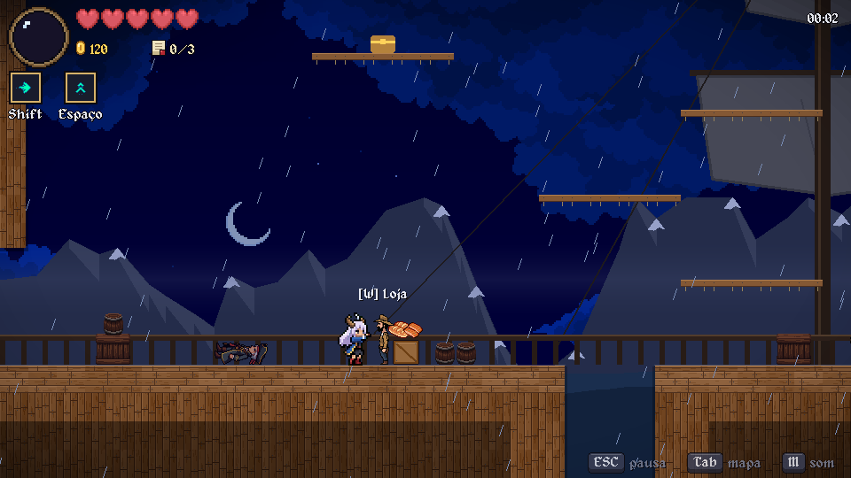
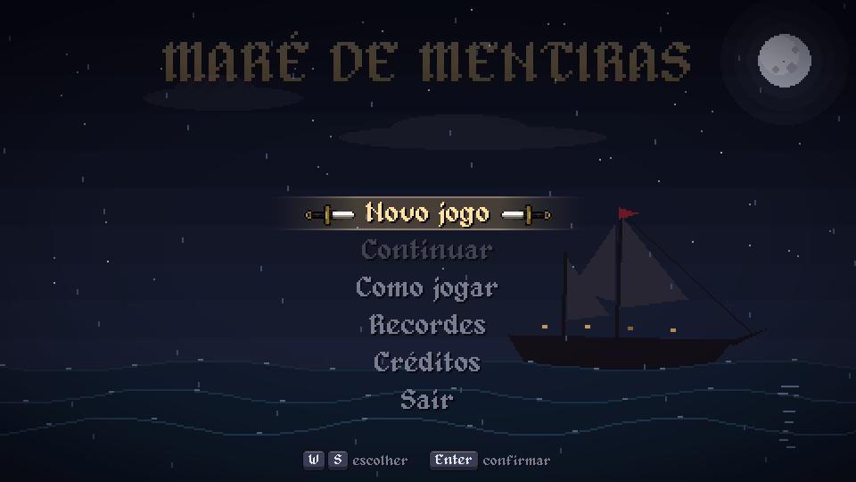
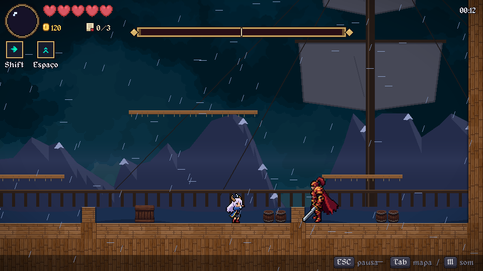

# Maré de Mentiras

Metroidvania 2D de ação em pixel art, feito em Python com pygame-ce.



## ▶ Baixar e jogar (Windows)

Baixe **MareDeMentiras.exe** em [Releases](https://github.com/GabrielLima2006/JogoA3/releases/latest)
e dê dois cliques. Não precisa instalar nada. Se o Windows avisar "O Windows protegeu o computador",
clique em **Mais informações** e depois em **Executar assim mesmo** (o executável não é assinado).

## 1. Identificação

| | |
|---|---|
| **Jogo** | Maré de Mentiras |
| **Grupo** | [nome do grupo] |
| **Disciplina** | Usabilidade, desenvolvimento web, mobile e jogos |
| **Professor** | Elzo Brito dos Santos Filho |
| **Instituição** | Universidade São Judas Tadeu (USJT), 2026 |

| Integrante | RA |
|---|---|
| [nome] | [RA] |
| [nome] | [RA] |
| [nome] | [RA] |

## 2. Descrição

> **Sinopse:** Nyra, uma meio-demônia de chifres que finge ser feiticeira, viaja no navio da Capitã Maren
> rumo à ilha de Velmora. A capitã cai envenenada, a tripulação fica enfeitiçada e uma criatura chamada Maré
> está acordando sob o Templo. Por trás de tudo está Caelum, o melhor amigo de Nyra, banido da academia de magia
> por um erro que era dela.
>
> História completa (personagens, falas, atos e finais): [docs/HISTORIA.md](docs/HISTORIA.md)

**Duração estimada:** 40 a 60 minutos na primeira vez; 60 a 80 minutos para pegar tudo; 15 a 20 minutos
para quem já conhece o caminho. (Estimativa; o tempo real aparece no HUD e fica salvo nos recordes.)


No reino de Aurel, Nyra esconde os chifres sob o capuz e vende truques como se fosse feiticeira. A bordo da
Gaivota Rubra, ela enfrenta a tripulação enfeitiçada, sobe o mastro na tempestade, desembarca em Velmora e
chega ao Templo da Maré. Cada chefe tem uma mecânica ligada ao mundo: os ratos do porão, o vento no
alto do mastro, o canhonaço do navio pirata e as ilusões do Feiticeiro da Maré. Três páginas escondidas do
diário da capitã revelam a história inteira e liberam o final verdadeiro.

- **3 áreas:** navio (cabine, convés, porão, cordame), ilha (praia, floresta, ruínas) e Templo da Maré.
- **4 chefes:** Tico (Rei dos Ratos, investida e ratos), Aldric (Cavaleiro Rubro, rajadas de vento), Selka
  (Canhoneira da Tempestade, canhonaço) e Caelum (Feiticeiro da Maré, ilusões e maré). Todos têm duas fases.
- **Habilidades:** dash (Passo ilusório) desde o começo; pulo duplo (Levitação) depois do primeiro chefe,
  abrindo caminho para o mastro e a ilha.
- **Parkour:** plataformas móveis, tábuas que desabam, espinhos, água e saltos que exigem as habilidades.
- **Itens:** moedas, comida que cura, amuletos, fragmentos de vida, loja e ferreiro.
- **Três dificuldades** (7, 5 ou 4 corações).
- **Dois finais:** comum e verdadeiro (com as 3 páginas do diário).

## 3. Como rodar

Requisitos: Python 3.10 ou mais novo.

```bash
pip install -r requirements.txt
```

```bash
python main.py
```

No Windows também dá para usar o executável da pasta `dist/MareDeMentiras/` (ver
[Gerar o executável](#gerar-o-executável)) ou dar dois cliques em `Jogar.bat`.

## 4. Controles

| Tecla | Ação |
|---|---|
| A / D ou setas | Mover |
| Espaço | Pular (segurar = pulo mais alto) |
| Espaço no ar | Pulo duplo (depois do primeiro chefe) |
| Shift esquerdo | Dash |
| Botão esquerdo do mouse | Ataque rápido |
| Botão direito do mouse | Ataque pesado |
| W / S + ataque | Golpe para cima, na diagonal ou para baixo (no ar, quica em inimigos e espinhos) |
| S | Descer de plataformas finas |
| F (segurar) | Curar (gasta o orbe de foco) |
| W ou seta para cima | Interagir (bola de cristal, loja, personagens) |
| Tab | Mapa |
| M | Ligar/desligar o som |
| ESC ou P | Pausar (continuar, som, reiniciar, menu) |

Os controles também aparecem no jogo, em **Como jogar** e na tela de pausa.

## 5. Regras

- **Objetivo:** vencer o chefe final no Templo da Maré. Vencer os chefes anteriores libera habilidades
  e caminhos novos.
- **Vida:** cada golpe recebido tira um coração. Com zero corações você **perde**: volta à última
  bola de cristal e deixa parte das moedas para trás.
- **Cura:** golpes acertados enchem o orbe de foco; segure **F** para trocar foco por um coração.
  Comida recupera 2 corações.
- **Salvar:** a bola de cristal (W) salva o jogo e recupera a vida.
- **Perigos:** espinhos e água ferem e devolvem você ao último chão firme. Tábuas rachadas desabam
  pouco depois de pisadas.
- **Vitória:** derrotar o chefe final. Com as 3 cartas da capitã você vê o **final verdadeiro**.
- **Pontuação:** na tela final aparecem tempo, quedas, cartas, pontos e uma nota (S, A, B ou C).
  O HUD mostra corações, moedas, cartas e o tempo de jogo o tempo todo.

## 6. Divisão de tarefas

| Integrante | Tarefas |
|---|---|
| [nome] | [ex.: programação da movimentação e combate] |
| [nome] | [ex.: level design e roteiro] |
| [nome] | [ex.: arte, sons e créditos] |

## 7. Créditos

Todos os assets de terceiros são gratuitos. Autor, link e licença de cada um estão em
[`assets/CREDITOS.md`](assets/CREDITOS.md) e também aparecem na tela **Créditos** do jogo.

> **Personagens novos em produção (PixelLab):** os personagens e as animações estão sendo refeitos no
> [PixelLab](https://www.pixellab.ai), ferramenta de geração de pixel art. Por enquanto só a protagonista foi
> feita: [personagem no PixelLab](https://www.pixellab.ai/create-character/ef1888d6-775c-41a3-8d0c-693294b46e44).
> Os demais personagens, inimigos e chefes ainda usam os sprites atuais e serão trocados aos poucos. Isso entra
> na seção [Uso de IA](#9-uso-de-ia).

| Asset | Autor | Uso |
|---|---|---|
| Super Pixel Effects Gigapack (Free) | Will Tice / unTied Games | Efeitos de golpe, explosões, fumaça, fogo, raios |
| Metroidvania Forge | [CONFIRMAR autor] | Capangas, Cavaleiro Rubro, slime, tiles da ilha, objetos, sons e músicas |
| Feiticeira (idle & walk) | [CONFIRMAR autor] | Protagonista |
| Dark VFX 01–02 / Smear VFX 01 | [CONFIRMAR autor] | Magias do vilão e rastro dos golpes |
| UIBundleFree (Mediavel) | [CONFIRMAR autor] | Interface |
| pixelfood | Ghostpixxells | Comidas (itens de cura) |
| Tiny Texture Pack 1 e 2 | Screaming Brain Studios (CC0) | Paredes de madeira do navio |
| Fonte Alagard | Hewett Tsoi | Todos os textos (os acentos são desenhados pelo jogo) |

As animações de golpe, pulo, queda, dash, dano e morte da protagonista foram criadas pela equipe a partir
do sprite original (`tools/gerar_feiticeira.py`). Os outros humanos (tripulação, irmã da capitã, capangas)
são variações do sprite dela com outras cores, cabelos e acessórios (`src/elenco.py`). O Rei dos Ratos, o
Feiticeiro da Maré, ratos, gaivotas, canhões e ícones de itens foram desenhados no código (`src/pixelart.py`).

## 8. Tecnologia

- **Linguagem:** Python 3.12
- **Biblioteca:** pygame-ce 2.5
- **Executável:** PyInstaller
- **Testes:** suíte própria sem dependências (`python tests/run_tests.py`), que simula o jogo sem
  janela e confere física, salas, portas, chefes, menus e se todos os saltos obrigatórios são possíveis
  com as habilidades de cada trecho.

Estrutura:

```
main.py              ponto de entrada (estados: menu, jogo, pausa, finais)
src/                 código do jogo (física, jogador, inimigos, chefes, salas, interface)
assets/img/          imagens (personagens, chefes, efeitos, tiles, objetos, interface)
assets/sons/         efeitos sonoros e músicas
assets/fonts/        fonte
tests/               testes automáticos
docs/screenshots/    capturas de tela do README
```

## 9. Uso de IA

[O grupo vai preencher esta seção: quais partes foram feitas com ajuda de IA, quais ferramentas
foram usadas e como o grupo revisou o resultado.]

## 10. Screenshots

| | |
|---|---|
|  |  |
|  |  |
|  |  |
|  |  |

## Gerar o executável

```bash
pip install pyinstaller
```

```bash
python -m PyInstaller --noconfirm --windowed --name MareDeMentiras --add-data "assets;assets" main.py
```

O jogo fica em `dist/MareDeMentiras/MareDeMentiras.exe`. Para enviar ao grupo, compacte a pasta
`dist/MareDeMentiras` inteira em um .zip. O save e os recordes ficam na pasta `saves/` ao lado do
executável.
