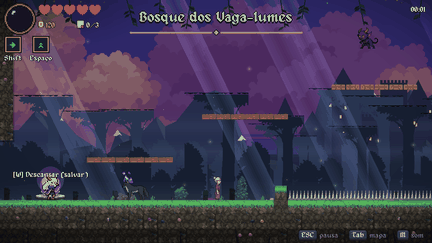
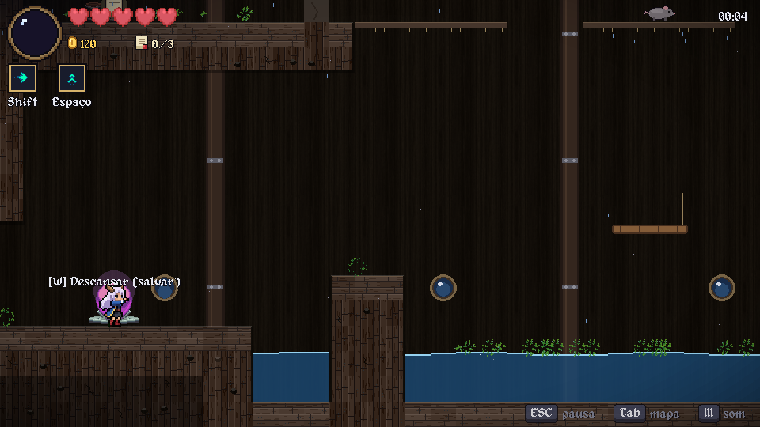

<div align="center">

# Maré de Mentiras

**Metroidvania 2D de ação em pixel art, a bordo de um navio enfeitiçado e numa ilha que esconde um templo.**


[](https://github.com/GabrielLima2006/JogoA3/releases/latest)

Instalador para Windows, sem precisar instalar Python. Leva de 40 a 60 minutos para terminar.

</div>

## Sobre

Nyra, uma meio-demônia de chifres que finge ser feiticeira, viaja no navio da Capitã Maren rumo à ilha de
Velmora. A capitã cai envenenada, a tripulação fica enfeitiçada e uma criatura chamada Maré desperta sob o
Templo. Para chegar ao fim, Nyra atravessa o navio, sobe o mastro na tempestade, desembarca na ilha e
descobre quem está por trás de tudo. Três páginas escondidas do diário da capitã contam a história inteira
e liberam o final verdadeiro.

<div align="center">



</div>

## Como jogar

1. Baixe **MareDeMentiras-Setup.exe** na [versão mais recente](https://github.com/GabrielLima2006/JogoA3/releases/latest).
2. Abra o instalador e siga os passos. O jogo fica no Menu Iniciar (e na Área de Trabalho, se você marcar)
   e pode ser removido em "Aplicativos instalados".
3. Se o Windows avisar "O Windows protegeu o computador", clique em **Mais informações** e depois em
   **Executar assim mesmo** (o instalador não é assinado).

Prefere não instalar? Na mesma página há o **MareDeMentiras.exe** portátil: é só dar dois cliques.

Pelo código-fonte (Python 3.10 ou mais novo): `pip install -r requirements.txt` e `python main.py`,
ou dois cliques em `Jogar.bat`, que instala o pygame-ce na primeira vez.

## Controles

| Tecla | Ação |
|---|---|
| A / D ou setas | Mover |
| Espaço | Pular (segurar = pulo mais alto; no ar, pulo duplo depois do primeiro chefe) |
| Shift esquerdo | Dash |
| Botão esquerdo do mouse | Ataque rápido |
| Botão direito do mouse | Ataque pesado |
| W / S + ataque | Golpe para cima, na diagonal ou para baixo (no ar, quica em inimigos e espinhos) |
| S | Descer de plataformas finas |
| F (segurar) | Curar com o orbe de foco |
| W ou seta para cima | Interagir (bola de cristal, loja, personagens) |
| Tab | Mapa |
| M | Som |
| ESC ou P | Pausa e inventário |

## Recursos

- **4 chefes, cada um com duas fases:** Tico, o Rei dos Ratos (investidas e ratos), Aldric, o Cavaleiro
  Rubro (rajadas de vento no alto do mastro), Selka, a Canhoneira da Tempestade (pistola, bote e canhonaço)
  e Caelum, o Feiticeiro da Maré (ilusões, raios e maré).
- **13 salas em 3 regiões:** o navio Gaivota Rubra (cabine, convés, porões, toca, cordame e gávea), a ilha
  de Velmora (praia, floresta e ruínas) e o Templo da Maré.
- **Habilidades que abrem caminho:** dash desde o começo e pulo duplo depois do primeiro chefe.
- **Parkour:** plataformas móveis, tábuas que desabam, espinhos, água e saltos que pedem as habilidades.
- **8 amuletos** para equipar na bola de cristal: Lâmina, Força, Ímã, Foco, Vigor, Vento, Coletor e Bússola.
- **Loja, ferreiro, comida que cura, fragmentos de vida** e um mapa para comprar.
- **3 dificuldades** (7, 5 ou 4 corações) e **2 finais**, com nota S, A, B ou C na tela de resultado.

## Capturas

| | | |
|---|---|---|
|  |  |  |
|  |  |  |
|  |  |  |

## Feito com

- **Python 3.12** e **[pygame-ce](https://pyga.me/) 2.5**
- **PyInstaller** (executável) e **Inno Setup** (instalador)
- Testes automáticos próprios (`python tests/run_tests.py`): simulam o jogo sem janela e conferem física,
  salas, portas, chefes, menus e se todos os saltos obrigatórios são possíveis.

```
main.py      ponto de entrada
src/         código do jogo (física, jogador, inimigos, chefes, salas, interface)
assets/      imagens, sons, músicas e fonte
tests/       testes automáticos
tools/       ferramentas de arte e o script do instalador
docs/        história, capturas e documentos de desenvolvimento
```

<details>
<summary>Gerar o executável e o instalador</summary>

```bash
pip install pyinstaller
```

```bash
python -m PyInstaller --noconfirm --onefile --windowed --name MareDeMentiras --icon tools/icone.ico --add-data "assets;assets" --distpath dist/onefile main.py
```

O portátil sai em `dist/onefile/MareDeMentiras.exe` e salva na pasta `saves/` ao lado dele. Para o
instalador, compile `tools/instalador.iss` no [Inno Setup 6](https://jrsoftware.org/isinfo.php); ele sai em
`dist/instalador/MareDeMentiras-Setup.exe`. Instalado, o jogo salva em `%APPDATA%\MareDeMentiras`.

</details>

## Créditos

Todos os assets de terceiros são gratuitos e têm licença conferida. Autor, link e licença de cada pacote
estão em [`assets/CREDITOS.md`](assets/CREDITOS.md), e os créditos também aparecem no próprio jogo.
História completa: [`docs/HISTORIA.md`](docs/HISTORIA.md).

## Autor

**Gabriel Costa** ([@GabrielLima2006](https://github.com/GabrielLima2006)): trabalho A3 da disciplina
Usabilidade, desenvolvimento web, mobile e jogos (prof. Elzo Brito dos Santos Filho), Universidade São Judas
Tadeu (USJT), 2026.
