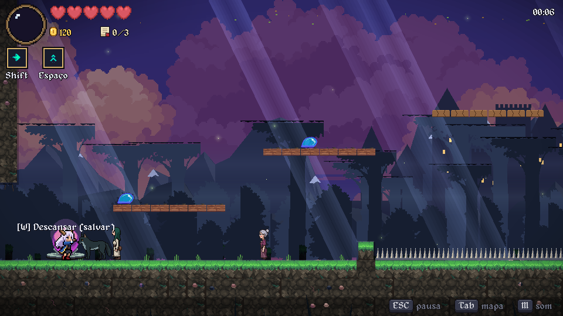
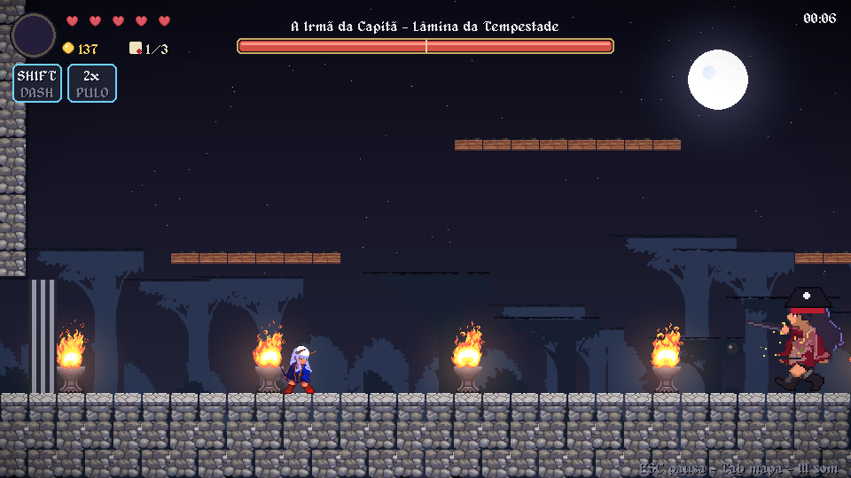
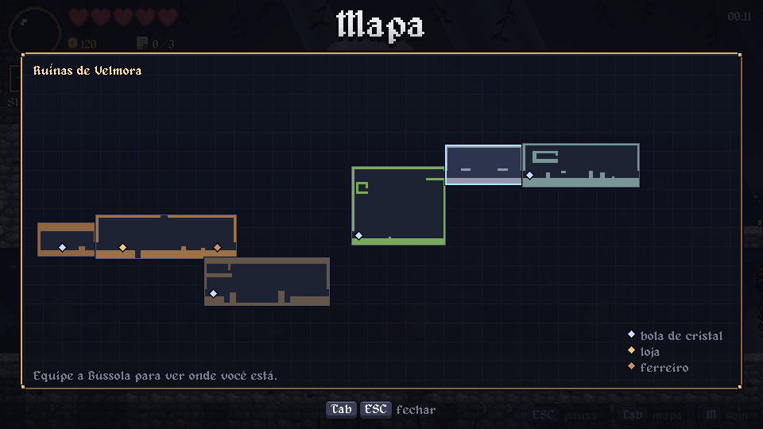
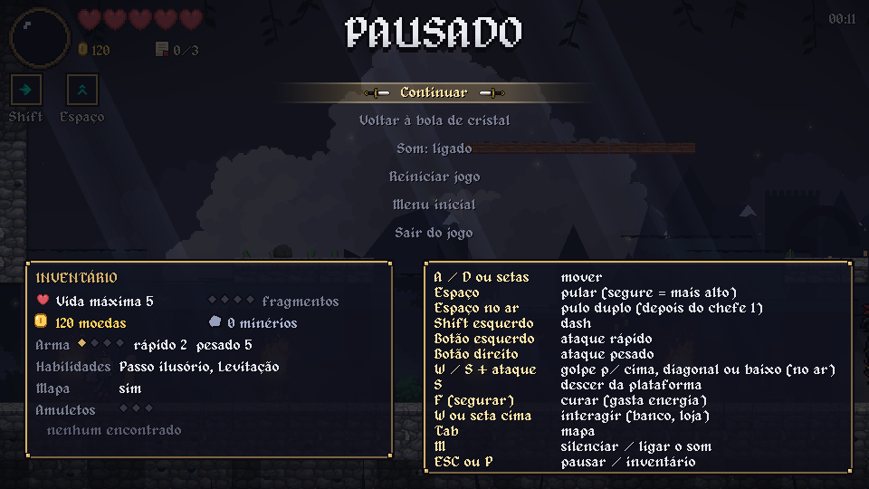

<div align="center">

# Maré de Mentiras

**Metroidvania 2D de ação em pixel art, a bordo de um navio enfeitiçado e numa ilha que esconde um templo.**


[](https://github.com/GabrielLima2006/JogoA3/releases/latest)

Instalador para Windows, sem precisar instalar Python. Leva de 40 a 60 minutos para terminar.

</div>

## Identificação

| | |
|---|---|
| **Jogo** | Maré de Mentiras |
| **Grupo** | Equipe Maré de Mentiras |
| **Unidade curricular** | Usabilidade, desenvolvimento web, mobile e jogos |
| **Professor** | Elzo Brito dos Santos Filho |
| **Instituição** | Universidade São Judas Tadeu (USJT), 2026 |

| Integrante | RA |
|---|---|
| Gabriel Lima Costa | 825251531 |
| Arthur Santana dos Santos | 825169114 |
| Gabriel Araujo Francisquete | 826188750 |
| Glória Fattorelli Carrion | 8261106681 |
| [5º INTEGRANTE] | [RA] |

## Sobre

Nyra, uma meio-demônia de chifres que finge ser feiticeira, viaja no navio da Capitã Maren rumo à ilha de
Velmora. A capitã cai envenenada, a tripulação fica enfeitiçada e uma criatura chamada Maré desperta sob o
Templo. Para chegar ao fim, Nyra atravessa o navio, sobe o mastro na tempestade, desembarca na ilha e
descobre quem está por trás de tudo. Três páginas escondidas do diário da capitã contam a história inteira
e liberam o final verdadeiro.

<div align="center">


</div>

## Como jogar

1. Baixe **MareDeMentiras-Setup.exe** na [versão mais recente](https://github.com/GabrielLima2006/JogoA3/releases/latest).
2. Abra o instalador e siga os passos. O jogo fica no Menu Iniciar (e na Área de Trabalho, se você marcar)
   e pode ser removido em "Aplicativos instalados".
3. Se o Windows avisar "O Windows protegeu o computador", clique em **Mais informações** e depois em
   **Executar assim mesmo** (o instalador não é assinado).

Prefere não instalar? Na mesma página há o **MareDeMentiras.exe** portátil: é só dar dois cliques.

### Como rodar pelo código-fonte

Pré-requisitos: **Python 3.10 ou mais novo** (com `pip`) e Windows, Linux ou macOS.

```bash
git clone https://github.com/GabrielLima2006/JogoA3.git
cd JogoA3
```

```bash
pip install -r requirements.txt
```

```bash
python main.py
```

No Windows também dá para dar dois cliques em `Jogar.bat`, que instala o pygame-ce na primeira vez.

## Controles

| Tecla | Ação |
|---|---|
| A / D ou setas | Mover |
| Espaço | Pular (segurar = pulo mais alto; no ar, pulo duplo depois do primeiro chefe) |
| Shift esquerdo | Dash |
| Botão esquerdo do mouse | Ataque rápido |
| Botão direito do mouse | Ataque pesado |
| W / S + ataque | Golpe para cima, na diagonal ou para baixo (no ar, quica em inimigos e espinhos) |
| S | Descer de plataformas finas |
| F (segurar) | Curar com o orbe de foco |
| W ou seta para cima | Interagir (bola de cristal, loja, personagens) |
| Tab | Mapa |
| M | Som |
| ESC ou P | Pausa e inventário |

## Regras

- **Objetivo (vitória):** atravessar o navio, a ilha e o Templo e derrotar Caelum, o Feiticeiro da Maré,
  no Altar. Cada chefe vencido libera habilidades e caminhos novos.
- **Vida e derrota:** cada golpe recebido tira um coração. Com zero corações a personagem cai: não é fim de
  jogo, ela volta à última bola de cristal usada e deixa as moedas numa bolsa no lugar onde caiu (dá para
  buscar de volta). Espinhos e água tiram um coração e devolvem ao último chão firme da sala.
- **Salvar e curar:** a bola de cristal (W) salva o jogo e recupera a vida; segurar **F** troca o orbe de foco,
  que enche ao acertar golpes, por um coração; comida recupera corações.
- **Pontuação:** no fim aparecem tempo, quedas, moedas, páginas do diário, pontos e nota.
  Pontos = 10000 − 2 × segundos − 300 × quedas + 5 × moedas + 1000 × páginas do diário.
  Nota **S** (3 páginas e até 3 quedas), **A** (até 6 quedas), **B** (até 12) ou **C**.
- **Finais:** com as 3 páginas do diário da capitã você vê o **final verdadeiro**.

## Recursos

- **4 chefes, cada um com duas fases:** Tico, o Rei dos Ratos (investidas e ratos), Aldric, o Cavaleiro
  Rubro (rajadas de vento no alto do mastro), Selka, a Canhoneira da Tempestade (pistola, bote e canhonaço)
  e Caelum, o Feiticeiro da Maré (ilusões, raios e maré).
- **13 salas em 3 regiões:** o navio Gaivota Rubra (cabine, convés, porões, toca, cordame e gávea), a ilha
  de Velmora (praia, floresta e ruínas) e o Templo da Maré.
- **Habilidades que abrem caminho:** dash desde o começo e pulo duplo depois do primeiro chefe.
- **Parkour:** plataformas móveis, tábuas que desabam, espinhos, água e saltos que pedem as habilidades.
- **8 amuletos** para equipar na bola de cristal: Lâmina, Força, Ímã, Foco, Vigor, Vento, Coletor e Bússola.
- **Loja, ferreiro, comida que cura, fragmentos de vida** e um mapa para comprar.
- **3 dificuldades** (7, 5 ou 4 corações) e **2 finais**, com nota S, A, B ou C na tela de resultado.

## Capturas

| | | |
|---|---|---|
|  |  |  |
|  |  |  |
|  |  |  |

## Feito com

- **Python 3.12** e **[pygame-ce](https://pyga.me/) 2.5**
- **PyInstaller** (executável) e **Inno Setup** (instalador)
- Testes automáticos próprios (`python tests/run_tests.py`): simulam o jogo sem janela e conferem física,
  salas, portas, chefes, menus e se todos os saltos obrigatórios são possíveis.

```
main.py      ponto de entrada
src/         código do jogo (física, jogador, inimigos, chefes, salas, interface)
assets/      imagens, sons, músicas e fonte
tests/       testes automáticos
tools/       ferramentas de arte e o script do instalador
docs/        história, capturas e documentos de desenvolvimento
```

<details>
<summary>Gerar o executável e o instalador</summary>

```bash
pip install pyinstaller
```

```bash
python -m PyInstaller --noconfirm --onefile --windowed --name MareDeMentiras --icon tools/icone.ico --add-data "assets;assets" --distpath dist/onefile main.py
```

O portátil sai em `dist/onefile/MareDeMentiras.exe` e salva na pasta `saves/` ao lado dele. Para o
instalador, compile `tools/instalador.iss` no [Inno Setup 6](https://jrsoftware.org/isinfo.php); ele sai em
`dist/instalador/MareDeMentiras-Setup.exe`. Instalado, o jogo salva em `%APPDATA%\MareDeMentiras`.

</details>

## Divisão de tarefas

| Integrante | Tarefas |
|---|---|
| Gabriel Lima Costa | Visão geral do projeto, laço do jogo e estados, movimento, pulo e tela, salas, mapa e save, demo e integração |
| Arthur Santana dos Santos | Combate, inimigos, chefes e dificuldades |
| Glória Fattorelli Carrion | Interface, som e configurações |
| Gabriel Araujo Francisquete | História, usabilidade e teste de instalação |
| [5º INTEGRANTE] | Arte e assets, créditos, declaração de IA e slides |

## Créditos

Todos os assets de terceiros são gratuitos e têm licença conferida. Autor, link e licença de cada pacote
estão em [`assets/CREDITOS.md`](assets/CREDITOS.md), e os créditos também aparecem no próprio jogo.
História completa: [`docs/HISTORIA.md`](docs/HISTORIA.md).

## Uso de IA

| Ferramenta | Para quê | Arquivos |
|---|---|---|
| **Claude Code** (Anthropic), assistente de programação | As mecânicas mais simples foram feitas pelo grupo à mão: **movimento, pulo e tamanho da tela/janela**. O restante do código foi desenvolvido com auxílio da IA e **revisado e testado pelo grupo** | ver lista abaixo |
| **PixelLab** (pixellab.ai) | Todos os personagens foram **desenhados à mão pelo grupo** e depois aprimorados e animados com IA no PixelLab | ver lista abaixo |
| — | **História:** escrita pelo grupo (textos em `src/chapter1.py` e `src/menus.py`, `docs/HISTORIA.md`) | — |
| — | **Assets de terceiros** (itch.io, Craftpix, DaFont): não são de IA; autor, link e licença em [`assets/CREDITOS.md`](assets/CREDITOS.md) | — |

**Feito à mão pelo grupo (sem IA):** movimento e pulo da personagem (`Player._horizontal`,
`Player._gravity`, `Player._try_jump` em `src/player.py`; valores em `Player` e `Physics` de
`src/config.py`) e tela/janela (`App.__init__` em `main.py`; `Display` em `src/config.py`).

**Código desenvolvido com auxílio do Claude Code (revisado e testado pelo grupo):**

| Parte | Arquivos |
|---|---|
| Laço, estados, pausa, morte, final | `main.py` (`App.run`), `src/states.py` |
| Física e colisão com tiles | `src/physics.py`, `src/camera.py`, `src/movers.py` |
| Jogador (dash, ataques, cura, dano) e combate | `src/player.py` (exceto as funções acima), `src/combat.py`, `src/amuletos.py` |
| Inimigos | `src/enemies.py`, `src/creatures.py` |
| Chefes | `src/bosses.py` |
| Salas, portas e mapa | `src/chapter1.py` (estrutura das salas), `src/rooms.py`, `src/world.py` |
| Save e recordes | `src/progress.py`, `src/records.py`, `src/paths.py` |
| Som | `src/audio.py` |
| Interface, menus, HUD, fonte | `src/ui.py`, `src/menus.py`, `src/fonte.py`, `src/input.py` |
| Visual por código e efeitos | `src/effects.py`, `src/background.py`, `src/paisagem.py`, `src/tiles.py`, `src/pixelart.py`, `src/elenco.py`, `src/sprites.py`, `src/skins.py`, `src/objects.py` |
| Testes e bot de QA | `tests/` (`run_tests.py`, `helpers.py`, `test_*.py`), `docs/qa/scripts/` |
| Ferramentas de arte e instalador | `tools/` (`animar_pose.py`, `importar_*.py`, `gerar_*.py`, `montar_banca.py`, `desenhar_maren_caida.py`, `capturar.py`, `instalador.iss`), `MareDeMentiras.spec`, `Jogar.bat` |

**Personagens desenhados pelo grupo e aprimorados/animados no PixelLab:**
- Protagonista Nyra: `assets/img/personagens/heroina.png` (originais em `assets/fontes/heroina/`).
- Chefes: Tico, o Rei dos Ratos — `assets/img/chefes/rei_rato_{parado,andando,ataque}.png`
  (originais em `assets/fontes/rei_rato/`); Aldric — `assets/img/chefes/aldric_{parado,andando,ataque}.png`;
  Selka e Caelum — `assets/img/personagens/selka.png`, `caelum.png`, `anim_selka.png`, `anim_caelum.png`.
- Capitã Maren: `assets/img/personagens/maren.png` (`maren_caida.png` desenhada à mão com a paleta dela).
- NPCs: `assets/img/personagens/npc_*.png` e `anim_*.png` (aldeã, anciã, ancião, bardo, comerciante,
  curandeira, estudioso, ferreira, grumete, pescador).
- Inimigos: `assets/img/personagens/inimigo_lobo.png`, `inimigo_goblin.png` e as folhas `anim_*.png`
  (diabrete, espírito, lich, ladino, cavaleiro do escudo); folhas de modelos `npcs.png` e
  `feiticeira_modelos.png`.
- Originais exportados do PixelLab: `assets/fontes/pixellab/`.

## Documentação

- [Como o jogo foi feito](docs/COMO_O_JOGO_FOI_FEITO.md): arquitetura, estados, física, combate, salas e testes.
- [História completa](docs/HISTORIA.md) e [créditos dos assets](assets/CREDITOS.md).
